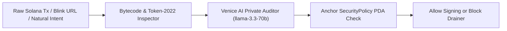

<p align="center">
  
</p>

<h1 align="center">SolShield</h1>

<p align="center">
  <strong>Private Solana Transaction Firewall, Blinks Inspector &amp; Anchor Policy Vault</strong><br>
  <em>Powered by <a href="https://venice.ai">Venice AI</a> Zero-Data-Retention Private Inference</em>
</p>

<p align="center">
  <a href="https://solshield-wine.vercel.app"></a>
</p>

<p align="center">
  <a href="https://builtinvenice.ai"></a>
  <a href="https://solana.com"></a>
  <a href="https://www.anchor-lang.com"></a>
  <a href="https://nextjs.org"></a>
  <a href="https://opensource.org/licenses/MIT"></a>
</p>

---

## Overview

**SolShield** is a non-custodial Solana transaction security firewall, **Solana Actions (Blinks)** inspector, and **Rust/Anchor On-Chain Policy Vault** powered by **[Venice AI](https://venice.ai)** private inference.

It protects Solana users from blind-signing wallet drainers (`SPL SetAuthority` owner hijacks, unlimited `ApproveChecked` delegate allowances, and malicious **Token-2022** `TransferHook` / `PermanentDelegate` extensions) while keeping wallet addresses, balances, and DeFi trading intent 100% private via Venice AI's zero-data-retention API.

---

## Why SolShield + Venice AI?

1. **Eliminate Blind-Signing on Solana & Blinks:** Decompiles raw wire-format Solana transactions (`Legacy` & `Versioned V0`) and Solana Action (`solana-action:`) payloads before signing.
2. **Zero-Data-Retention Financial Privacy (Powered by Venice AI):** Analyzing wallet transactions with traditional centralized AI providers leaks your public keys, net worth, and trading alpha into training logs. SolShield routes all transaction ASTs and natural-language DeFi intents through **Venice AI (`https://api.venice.ai/api/v1/chat/completions`)** with `include_venice_system_prompt: false` for uncensored, zero-retention security reasoning.
3. **On-Chain Guardrails via Anchor (`programs/solshield-policy`):** Includes a deterministic Solana program written in **Rust (Anchor v0.30.1)** that enforces per-wallet `SecurityPolicy` PDAs (`max_daily_spend_lamports` in a 24h rolling window, `max_allowed_risk_score`, `whitelisted_programs`, and an instant `emergency_locked` circuit breaker).

---

## System Architecture



### Repository Structure

```text
solshield/
├── programs/
│   └── solshield-policy/
│       └── src/lib.rs                  # Rust / Anchor smart contract (SecurityPolicy PDA)
├── src/
│   ├── lib/
│   │   ├── solana-parser.ts            # Wire-format Solana Tx decompiler & Token-2022 hook detector
│   │   ├── venice-ai.ts                # Venice AI API integration (Risk Audit + DeFi Intent Parser)
│   │   ├── anchor-idl.ts               # Deterministic PDA derivation & IDL helper
│   │   └── presets.ts                  # Real serialized Solana attack & safe swap scenarios
│   └── app/
│       ├── page.tsx                    # Interactive Firewall, Intent Copilot & PDA Vault UI
│       └── api/
│           ├── audit/route.ts          # POST transaction simulation & Venice AI audit API
│           ├── intent/route.ts         # POST natural-language intent to guarded Jupiter swap
│           └── actions/audit-swap/     # Official Solana Actions & Blinks GET/POST/OPTIONS endpoint
├── public/
│   └── actions.json                    # Solana Actions discovery manifest
└── tests/
    ├── firewall-engine.test.ts         # Vitest unit test suite for parser, Venice audit & PDA policies
    └── solshield-policy.anchor.ts      # Anchor program integration test helper
```

---

## Security & Smart Contract Engineering Highlights

### 1. Anchor Program (`programs/solshield-policy/src/lib.rs`)
* **Canonical PDA Validation:** Derives per-wallet policy state at `seeds = [b"solshield_policy", owner.key().as_ref()]` with canonical bump verification.
* **Strict Authority Constraints:** Uses `has_one = owner @ SolShieldError::UnauthorizedOwner` and `Signer<'info>` on all policy mutations (`update_policy`, `manage_whitelist`, `set_emergency_lock`, `verify_and_record_execution`).
* **Checked Arithmetic & Rolling 24h Window:** Uses `.checked_add()` and `.checked_sub()` with `Clock::get()?.unix_timestamp` to reset and enforce daily lamport spending limits safely without integer overflow vulnerabilities.

### 2. Bytecode Threat Detection (`src/lib/solana-parser.ts`)
* **`OWNER_AUTHORITY_HIJACK`:** Detects `SPL Token Instruction Tag 6 (SetAuthority)` reassigning `AccountOwner` or `CloseAccount` authority to an external attacker.
* **`TOKEN_2022_UNVERIFIED_TRANSFER_HOOK` & `TOKEN_2022_PERMANENT_DELEGATE`:** Inspects `TokenzQdBNbLqP5VEhdkAS6EPFLC1PHnBqCXEpPxuEb` instructions for unverified 5th-account `TransferHook` CPI programs and `PermanentDelegate` (Tag 35) clawback authorities.
* **`UNLIMITED_DELEGATE_APPROVAL`:** Flags `Approve` / `ApproveChecked` instructions granting persistent token allowances.

---

## User Safety, Wallet Permissions & Privacy Disclosure

* **100% Non-Custodial:** SolShield never asks for, accesses, or stores private keys or seed phrases. All transaction analysis is read-only pre-sign simulation.
* **Bring Your Own Key (BYOK) Client Privacy:** When you enter a Venice API Key in the UI header, it is stored exclusively in your browser's `sessionStorage` and used solely to authenticate requests to `https://api.venice.ai/api/v1/chat/completions`.
* **Disclaimer:** SolShield is an independent open-source community project built on the Venice AI API and is not an official Venice AI product.

---

## Quick Start (Local Development)

```bash
# 1. Install dependencies
npm install

# 2. Run the automated security & unit test suite
npm test

# 3. Start the local Next.js development server
npm run dev
```

Open `http://localhost:3000` in your browser. You can test all 4 live wire-format Solana transaction presets immediately, or click **Configure Venice API Key (BYOK)** in the top navigation bar to enable live Venice LLM inference.

### Optional Environment Variables (`.env.local`)

```env
# Optional server-side fallback key (users can also supply their own key via UI BYOK)
VENICE_API_KEY=your_venice_api_key_here
```

---

## License

MIT
